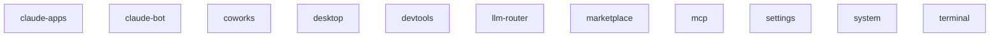

# 架构概览

> 由 wiki_gen 生成。

## 声明架构

- 架构风格: layered
- 主语言: TypeScript/Rust

## 模块映射

| 模块 | 路径 | 职责 | 接口 | 实体 |
|--------|-------|---------|------------|----------|
| claude-apps | `src/components/claudeApps/`, `src/components/DynamicFunctionCreator.vue`, `src/components/DynamicFunctionHost.vue`, `src/stores/dynamicFunctionStore.ts`, `src/composables/claudeApps/`, `src-tauri/src/dynamic_function.rs` | Lightweight app (dynamic function) system for creating, managing and running user-defined mini-apps with optional backend support and conversation history | df_list_functions, df_create_function, df_start_backend | DynamicFunction, BackendStatus, ConversationIndexItem |
| claude-bot | `src/components/claudeBot/`, `src/stores/botStore.ts`, `src/composables/claudeBot/`, `src-tauri/src/claude_bot.rs`, `src-tauri/src/channels/`, `src-tauri/src/scheduler_heartbeat.rs` | Autonomous Claude Bot engine with multi-channel integration (Discord, Telegram, Feishu) and task scheduling | createBot, startBot, channel_send | Bot, Channel |
| coworks | `src/components/coworks/`, `src/components/Coworks.vue`, `src/components/CoworksModelSettings.vue`, `src/stores/devtoolsStore.ts`, `src/composables/coworks/`, `src-tauri/src/coworks_config.rs`, `src-tauri/src/coworks_fs.rs`, `src-tauri/src/coworks_sidecar.rs`, `sidecar/coworks/` | AI-powered collaboration hub with three modes: Chat (conversation), Code (development with file tree), and Cowork (full collaboration with Claude Agent SDK) | startSession, sendMessage, sidecar_spawn | CoworkSession, ChatMessage |
| desktop | `src/components/Desktop.vue`, `src/components/WindowManager.vue`, `src/components/Window.vue`, `src/components/Taskbar.vue`, `src/components/DesktopIcon.vue`, `src/components/WidgetPanel.vue`, `src/components/FileManager.vue`, `src/stores/desktopStore.ts`, `src/stores/windowStore.ts`, `src/stores/fileSystemStore.ts` | Virtual desktop environment with icon management, multi-window system, taskbar, widget panel and virtual file manager | openWindow, closeWindow, focusWindow | DesktopIcon, Window, FileNode |
| devtools | `src/components/devtools/`, `src/components/DevTools.vue`, `src/stores/devtoolsStore.ts`, `src-tauri/src/devtools.rs` | Developer tools for inspecting Cowork sessions, agent hierarchies, tool invocations, and performance metrics | getSessionMetrics | ToolCall |
| llm-router | `src/components/LlmRouter.vue`, `src-tauri/src/llm_router.rs` | Claude Code Router (CCR) for configuring LLM model routing, providers, and API endpoints | getRouterConfig, setRouterConfig | RouterConfig |
| marketplace | `src/components/market/`, `src/components/PluginMarket.vue`, `src/components/PluginMarketFull.vue`, `src/stores/marketplaceStore.ts`, `src/stores/pluginStore.ts`, `src-tauri/src/marketplace.rs`, `src-tauri/src/skills.rs` | Plugin marketplace for discovering, installing and managing Claude Code extensions (skills, agents, commands, MCP servers) | searchPlugins, installPlugin, uninstallPlugin | Plugin |
| mcp | `src/components/McpManager.vue`, `src-tauri/src/mcp.rs` | Model Context Protocol (MCP) server configuration and management, supporting global and project-level servers | listMcpServers, addMcpServer, removeMcpServer | McpServer |
| settings | `src/components/Settings.vue`, `src/components/ClaudeAliases.vue`, `src/stores/settingsStore.ts`, `src-tauri/src/window_state.rs`, `src-tauri/src/app_paths.rs` | Application settings management including theme, environment variables, Claude aliases, window state persistence, and data directory paths | getSettings, saveSettings, getWindowState | AppSettings, ClaudeAlias |
| system | `src-tauri/src/nodejs.rs`, `src-tauri/src/git.rs`, `src-tauri/src/uv.rs`, `src-tauri/src/system_aliases.rs`, `src-tauri/src/updater.rs`, `src/components/SetupGuide.vue`, `src/components/SetupGuideWindow.vue`, `src/components/UpdateModal.vue`, `src/composables/useSetupGuide.ts`, `src/composables/useAutoUpdate.ts` | System dependency management (Node.js, Git, UV), auto-update mechanism, first-run setup guide, and system alias resolution | checkDependencies, checkForUpdate, installUpdate | SystemDependency |
| terminal | `src/components/Terminal.vue`, `src/components/TerminalFilePanel.vue`, `src/components/TerminalSkillPanel.vue`, `src/stores/terminalStore.ts`, `src/composables/useTerminalPty.ts`, `src-tauri/src/pty.rs`, `src-tauri/src/node_pty.rs` | Cross-platform pseudo-terminal (PTY) with xterm.js UI, supporting both Unix portable-pty and Windows ConPTY | pty_spawn, pty_write, pty_resize | PtySession |

## 边界规则

- 每个模块只能写入其所属路径下的文件。
- 跨模块依赖通过接口定义，不直接导入内部实现。

## 架构决策

- **postMessage bridge for app-host communication**
  - 理由: Secure iframe isolation with controlled API surface via mcd.exec/mcd.kill/mcd.openExternal
  - 备选方案: Direct DOM access, WebSocket bridge
- **Filter via Claude Agent SDK one-shot script**
  - 理由: Replaced HTTP proxy with tokio subprocess for simplicity and reliability
  - 备选方案: HTTP proxy filter, In-process filter
- **Sidecar process for Claude Agent SDK**
  - 理由: Isolates Node.js runtime from Rust backend, prevents crash propagation
  - 备选方案: In-process WASM, HTTP microservice
- **Pinia store for window/icon state**
  - 理由: Centralized state management consistent with Vue 3 ecosystem
  - 备选方案: provide/inject, event bus
- **Read-only observer pattern**
  - 理由: DevTools reads from devtoolsStore shared with Coworks, avoiding data duplication
  - 备选方案: Separate data collection pipeline, WebSocket stream
- **Environment variable injection for routing**
  - 理由: Claude Code reads provider/model from env vars; router writes to the terminal env before session start
  - 备选方案: Direct config file modification, CLI flags
- **Git-based plugin distribution**
  - 理由: Leverages existing Git infrastructure, no custom registry needed
  - 备选方案: npm registry, Custom HTTP API
- **Dual-scope configuration (global + project)**
  - 理由: Matches Claude Code's native settings.json structure, project-level overrides for team sharing
  - 备选方案: Single global config, Database-backed registry
- **Explicit empty env injection for unconfigured aliases**
  - 理由: Prevents inheriting system ENV values when alias has no overrides
  - 备选方案: Skip injection, Inherit all system values
- **Bundled Node.js for macOS**
  - 理由: Ensures consistent Node.js version for sidecar processes
  - 备选方案: System Node.js only, WASM-based runtime
- **Dual PTY backend: portable-pty (Unix) + ConPTY (Windows)**
  - 理由: Native performance on each platform
  - 备选方案: node-pty via sidecar

## 错误策略

- **approach**: Result/Error propagation in Rust, try-catch in TypeScript
- **retry_policy**: no automatic retry for user-facing operations
- **fallback_behavior**: graceful degradation with user notification

## 模块依赖图



```
Module Dependencies
┌─────────────┐  ┌─────────────┐  ┌─────────────┐  ┌─────────────┐
│ claude-apps │  │ claude-bot  │  │ coworks     │  │ desktop     │
└─────────────┘  └─────────────┘  └─────────────┘  └─────────────┘

┌─────────────┐  ┌─────────────┐  ┌─────────────┐  ┌─────────────┐
│ devtools    │  │ llm-router  │  │ marketplace │  │ mcp         │
└─────────────┘  └─────────────┘  └─────────────┘  └─────────────┘

┌─────────────┐  ┌─────────────┐  ┌─────────────┐
│ settings    │  │ system      │  │ terminal    │
└─────────────┘  └─────────────┘  └─────────────┘

(no inter-module edges detected)
```

## 跨模块依赖

| 源模块 | 目标模块 | 依赖类型 | 说明 |
|--------|---------|---------|------|
| desktop | coworks, terminal, claude-apps | UI 入口 | 通过窗口注册调用各模块 UI 入口 |
| coworks | settings | 环境注入 | 启动 session 前读取 env vars 和 aliases |
| claude-bot | settings | 环境注入 | Bot 启动前读取 channel credentials 和 env vars |
| claude-bot | coworks | 运行时 | Bot 使用 Claude Agent SDK sidecar 执行过滤 |
| marketplace | mcp, claude-bot, coworks | 运行时发现 | 安装的插件被 MCP/Bot/Coworks 在运行时发现 |
| llm-router | coworks, claude-bot | 配置流 | Router 配置通过 env 注入影响 Claude session |
| devtools | coworks | 只读观察 | 从 Cowork session store 读取数据，不写入 |
| system | coworks, terminal, claude-bot | 前置依赖 | 提供 Node.js/Git/UV 检测供其他模块使用 |
